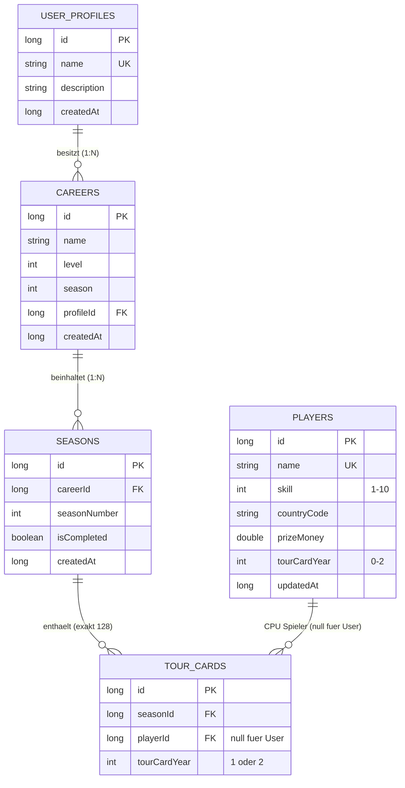

# 🏛️ System-Architektur & Datenmodell

Dieses Dokument bietet einen Gesamtüberblick über die Architektur, die Datenbank-Struktur und die Datenflüsse der **Danny Darts App**.

---

## 📐 1. Gesamtarchitektur (MVVM + Repository Pattern)

Die App folgt den empfohlenen Android-Architekturprinzipien mit **Model-View-ViewModel (MVVM)** und **Kotlin Coroutines / Flow**:

```
[ UI Layer: Activities / ViewModels ]
                 │
                 ▼
[ Repository Layer: CareerRepository, UserProfileRepository, SeasonRepository ]
                 │
                 ▼
[ Local Data Layer: Room DB (AppDatabase v12) ]
   ├── UserProfileDao
   ├── CareerDao
   ├── SeasonDao
   ├── TourCardDao
   └── PlayerDao
```

---

## 🗄️ 2. Room Datenbank Schema (`AppDatabase` v12)



### 2.1 Tabellen-Beschreibung

1. **`user_profiles`**: Speichert menschliche Nutzerprofile (z. B. "Danny").
2. **`careers`**: Speichert Karrieren. Verweist per Fremdschlüssel `profile_id` auf `user_profiles.id` (`CASCADE`).
3. **`seasons`**: Speichert Saisons einer Karriere. Verweist per `career_id` auf `careers.id` (`CASCADE`).
4. **`tour_cards`**: Speichert die exakt 128 Tourcard-Inhaber pro Saison.
   - `player_id = null` -> Der menschliche User der Karriere.
   - `player_id != null` -> CPU-Spieler aus `players`.
   - Property `isUser`: `playerId == null`.
5. **`players`**: Stammdatenbank aller Dart-Profis (importiert aus `players.csv`).

---

## 🔄 3. CSV-Spielerimport & Synchronisation

- Stammdaten der CPU-Spieler liegen in `app/src/main/assets/players.csv`.
- Beim ersten Start oder bei Erhöhung von `CURRENT_CSV_VERSION` in `AppDatabase.kt` führt `syncPlayersFromCsv` folgende Schritte aus:
  1. `csvInsertNewPlayers`: Fügt neue Spieler hinzu (sofern der Name nicht existiert).
  2. `csvUpdatePlayerStats`: Aktualisiert Skill, Land, Preisgeld und Stammdaten bestehender Spieler ohne deren Datenbank-ID zu verändern.

---

## 📝 5. Entwicklungsrichtlinien & Doku-Pflegepflicht

> **WICHTIG FÜR ALLE ENTWICKLER & KI-ASSISTENTEN:**
> Bei JEDER Änderung an Datenmodellen, Datenbank-Schemas (Room DB), Fachlogiken (z. B. Saisons, Turniere, Ranglisten) oder Systemabläufen **MUSS** die entsprechende Dokumentation im `docs/`-Ordner (`ARCHITEKTUR.md`, `SAISON_LOGIK.md` etc.) aktualisiert werden. 
> 
> Vor dem Abschluss jeder Aufgabe ist zu prüfen:
> 1. Wurden Datenbank-Versionen oder Entitäten verändert? -> In `ARCHITEKTUR.md` nachführen.
> 2. Wurden fachliche Regeln angepasst oder erweitert? -> In der entsprechenden Fachdoku in `docs/` nachführen.

---

## 📚 4. Weiterführende Dokumentation

- [🎯 Fachkonzept & Saison-Logik](file:///C:/Users/Danny/AndroidStudioProjects/DannyViewsApp/docs/SAISON_LOGIK.md)
